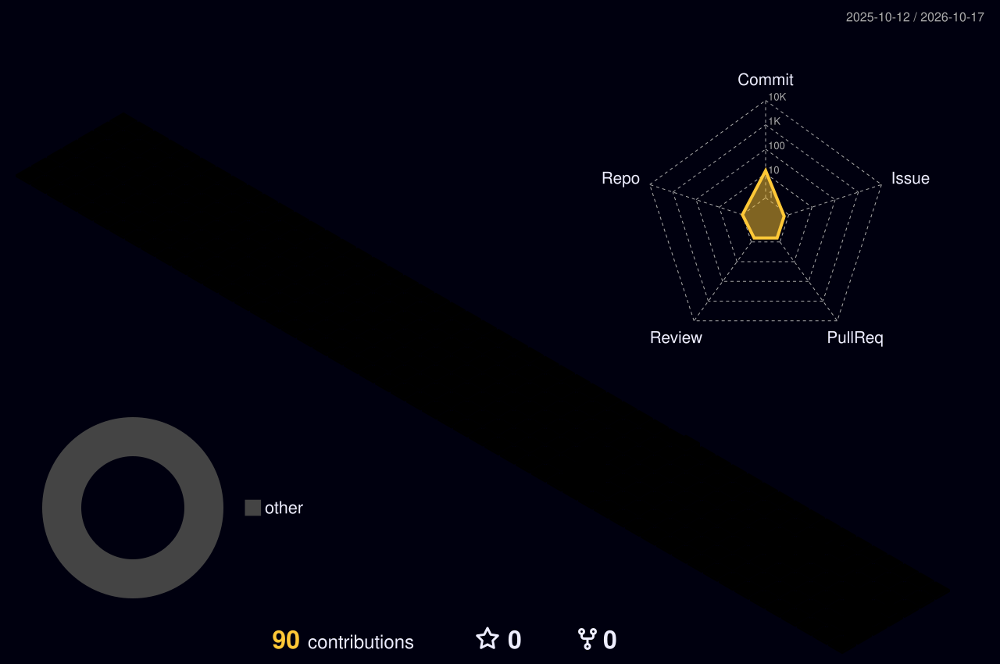

<!--

-->

<!--

-->

<!--
## Skills

-->

<!--

-->

  <picture>
    <source media="(prefers-color-scheme: dark)" srcset="https://raw.githubusercontent.com/SS-Amir/SS-Amir/output/github-snake-dark.svg">
    <source media="(prefers-color-scheme: light)" srcset="https://raw.githubusercontent.com/SS-Amir/SS-Amir/output/github-snake.svg">
    
  </picture>

